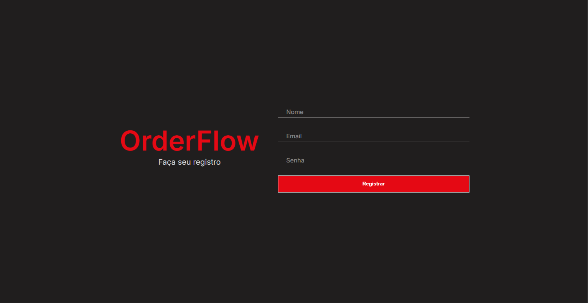
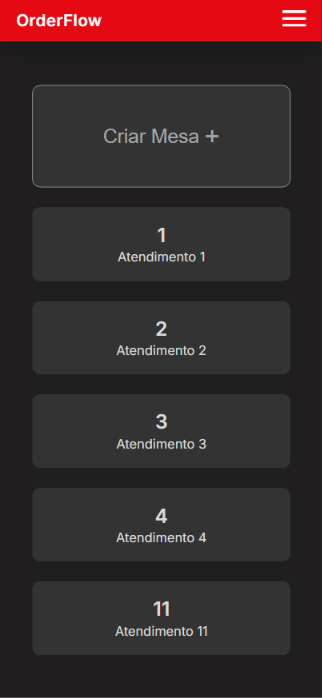
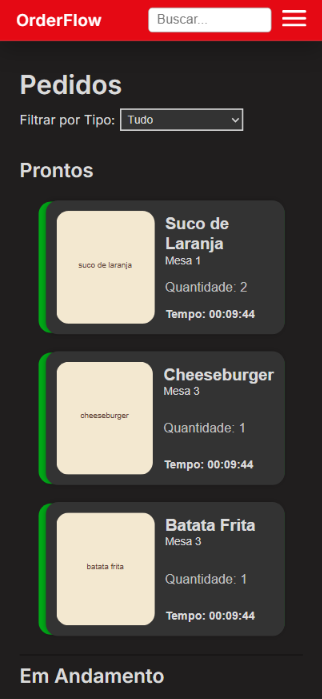
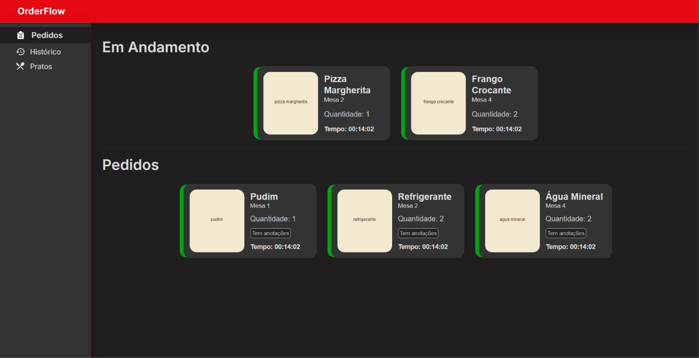
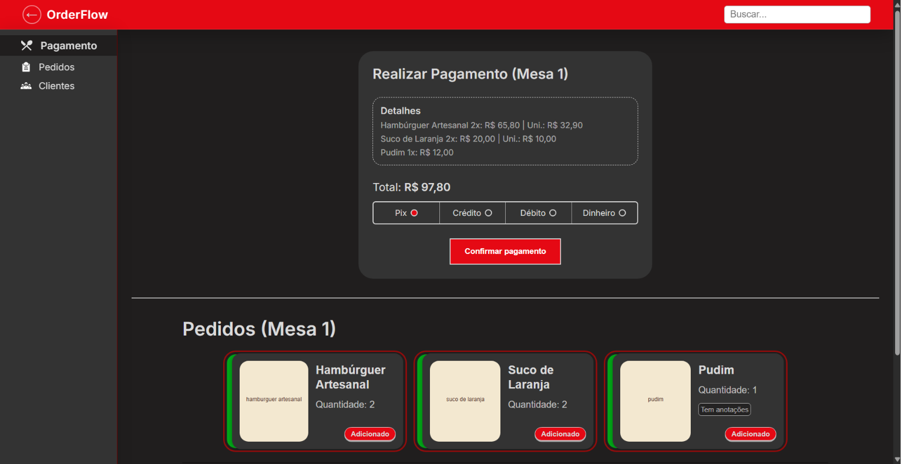
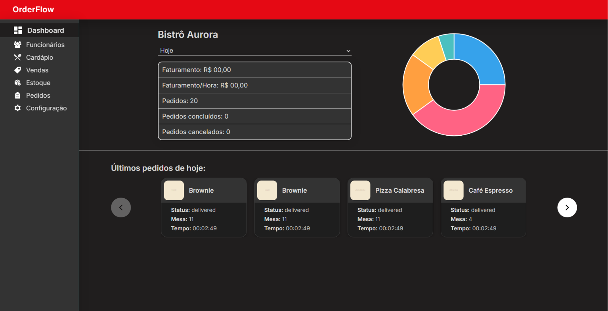

# OrderFlow

**Sistema de gerenciamento de pedidos, mesas e operações para bares, restaurantes e lanchonetes.**

O OrderFlow é uma aplicação web Full Stack que centraliza o fluxo de atendimento de um estabelecimento, conectando garçons, cozinha, caixa e gerência em um único sistema.

A plataforma acompanha as etapas da operação: abertura de mesas, registro de pedidos, preparo, finalização de contas e consulta de informações gerenciais.

> 🚧 **Status:** Em desenvolvimento ativo.

## Visão geral

<!-- TODO: Adicionar uma captura de tela principal da aplicação em docs/images/orderflow.png -->



## Funcionalidades

### Garçom

- Visualização, seleção e abertura de mesas.
- Consulta ao cardápio e aos itens disponíveis.
- Registro de pedidos vinculados às mesas, com quantidades e observações.
- Acompanhamento do andamento dos pedidos e consulta ao histórico.

### Cozinha

- Visualização e organização dos pedidos por status.
- Consulta aos itens, mesas e observações.
- Atualização do andamento do preparo.
- Consulta ao histórico de pedidos.

### Caixa

- Visualização das contas encaminhadas para pagamento.
- Consulta aos pedidos e valores das mesas.
- Registro de pagamentos e finalização das contas.

> **Importante:** o sistema registra os pagamentos, mas não processa transações financeiras, cobranças em cartões ou operações bancárias.

### Gerência

- Cadastro e gerenciamento de funcionários.
- Gerenciamento de cardápios e itens.
- Cadastro de produtos com preços, descrições e imagens.
- Visualização de indicadores operacionais.
- Análise de dados por período, com gráficos e informações gerenciais.

## Fluxo operacional

1. **Abertura:** o garçom seleciona e abre uma mesa.
2. **Pedido:** os itens do cardápio são adicionados à conta.
3. **Preparo:** os pedidos ficam disponíveis para a cozinha.
4. **Acompanhamento:** a equipe atualiza os status dos pedidos.
5. **Finalização:** os pedidos seguem para o caixa.
6. **Pagamento:** o caixa registra o pagamento e finaliza a conta.
7. **Análise:** os dados da operação ficam disponíveis para a gerência.

## Tecnologias

| Categoria                   | Tecnologias                  |
| --------------------------- | ---------------------------- |
| Front-end                   | HTML, CSS e JavaScript       |
| Back-end                    | Node.js                      |
| Banco de dados              | PostgreSQL                   |
| Armazenamento de arquivos   | Supabase Storage             |
| Autenticação                | JSON Web Token (JWT)         |
| Testes                      | Jest                         |
| Qualidade de código         | ESLint, Prettier e Stylelint |
| Ambiente de desenvolvimento | Docker Compose               |
| Gráficos                    | Chart.js                     |
| Automação                   | GitHub Actions               |

## Arquitetura e organização

O back-end foi estruturado com base em princípios da **Clean Architecture**, buscando separar responsabilidades e manter as regras de negócio menos dependentes dos detalhes de infraestrutura.

As principais camadas são:

- **Domain:** entidades e casos de uso que representam as regras e operações do negócio.
- **Presentation:** componentes responsáveis por receber e tratar as requisições HTTP.
- **Infrastructure:** implementações de persistência de dados e integrações externas.
- **Main:** inicialização da aplicação e composição das dependências.

A aplicação também utiliza **injeção de dependências** para conectar as implementações às camadas que as utilizam.

O servidor HTTP é construído com o módulo nativo `node:http` do Node.js.

## Capturas de tela

<!-- TODO: Adicionar capturas reais nos arquivos abaixo:
docs/images/mesas.png
docs/images/pedidos.png
docs/images/cozinha.png
docs/images/caixa.png
docs/images/dashboard.png
-->

<table>
  <tr>
    <td align="center" valign="top" width="50%">
      <b>Mesas</b><br><br>
      
    </td>
    <td align="center" valign="top" width="50%">
      <b>Pedidos</b><br><br>
      
    </td>
  </tr>
  <tr>
    <td align="center" valign="top" width="50%">
      <b>Cozinha</b><br><br>
      
    </td>
    <td align="center" valign="top" width="50%">
      <b>Caixa</b><br><br>
      
    </td>
  </tr>
  <tr>
    <td align="center" valign="top" colspan="2">
      <b>Dashboard gerencial</b><br><br>
      
    </td>
  </tr>
</table>

## Executando localmente

### Pré-requisitos

- Node.js e npm.
- Docker e Docker Compose.
- Um projeto no [Supabase](https://supabase.com) para o armazenamento das imagens dos produtos.

### Instalação

```bash
git clone https://github.com/vinnydarostrindad/orderflow.git
cd orderflow
npm install
```

### Configuração

Crie o arquivo `.env.development` na raiz do projeto. Exemplo com valores fictícios:

```env
# Banco de dados (PostgreSQL)
POSTGRES_USER=orderflow
POSTGRES_PASSWORD=sua_senha
POSTGRES_DB=orderflow
POSTGRES_HOST=localhost
POSTGRES_PORT=5432

# Supabase Storage
SUPABASE_URL=https://seu-projeto.supabase.co
SUPABASE_SERVICE_ROLE_KEY=sua_service_role_key
```

<!-- TODO: Adicionar as demais variáveis exigidas pela aplicação (ex.: segredo do JWT, porta do servidor). -->

> **Atenção:** a `SUPABASE_SERVICE_ROLE_KEY` concede acesso total ao projeto. Use-a apenas no back-end e nunca a envie ao repositório (confirme que `.env*` está no `.gitignore`).

As imagens dos produtos ficam no bucket público `orderflow` do Supabase Storage. No banco, é armazenado apenas o caminho do arquivo (`image_path`).

### Inicialização

```bash
npm run dev
```

Esse comando inicia os serviços definidos no Docker Compose, aguarda a disponibilidade do banco de dados, executa as migrações e inicia o servidor em modo de desenvolvimento.

### Testes

```bash
# Testes unitários
npm run test:unit

# Testes de integração
npm run test:integration
```

## Licença

Este projeto está licenciado sob a [Licença MIT](LICENSE).
